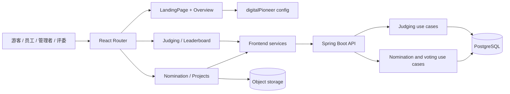

# 技术设计：2026 BDCN Digital Pioneer Award

## 1. 设计原则

1. 在现有系统内完成，不另建前端、不新增依赖。
2. 静态奖项内容集中在现有配置，业务约束由后端执行。
3. 个人提名复用现有 Idea 存储，但不再制造团队记录。
4. 精确文案只保留一个权威副本，测试按需求字符串断言。
5. 优先修改共享根因，避免在多个调用方重复加守卫。

## 2. 现有技术边界

以当前 `app/` 为实现仓库：

- 前端：React 19、TypeScript、Vite 7、Mantine 8、React Router。
- 后端：Java 21、Spring Boot、Spring Security。
- 数据：PostgreSQL/Flyway；照片存入现有 MinIO/object storage。
- 测试：Vitest + Testing Library、Spring/JUnit、PostgreSQL 集成测试、Playwright。

本轮不替换框架、设计系统、鉴权方式、存储方式或评分模型。

## 3. 系统流向



首页和概览可在业务 API 不可用时展示静态内容；候选人、提名、投票和评分必须以服务器结果为准。

## 4. 路由与组件映射

以下路径均相对于 `../app/`。

| 需求区域 | 主要实现 | 需求 ID |
| --- | --- | --- |
| 路由和公开外壳 | `hackhub-app/src/App.tsx` | DP-HOME-003、DP-HOME-004、DP-GEN-006 |
| 首页首屏 | `hackhub-app/src/pages/LandingPage.tsx`、`LandingPage.css` | DP-HOME-001..004、DP-GEN-001 |
| 奖项概览 | `hackhub-app/src/pages/DigitalPioneerOverview.tsx` | DP-OVR-001..004、DP-TIME-003 |
| 共用视觉样式 | `hackhub-app/src/pages/DigitalPioneer.css` | DP-GEN-002..005、DP-TRACK-002、DP-TRACK-003 |
| 正式奖杯插图 | `hackhub-app/src/components/DigitalPioneer/AwardLens.tsx`、`AwardLens.css` | DP-OVR-003 |
| 赛道/时间线/评分常量 | `hackhub-app/src/config/digitalPioneer.ts` | DP-TRACK-001、DP-TRACK-004、DP-TIME-001、DP-TIME-002、DP-JUDGE-002 |
| 提名和候选人 | `hackhub-app/src/pages/ProjectShowcase.tsx` | DP-NOM-001..008、DP-BROWSE-001..003 |
| 前端 API/上传 | `hackhub-app/src/services/ideaService.ts`、`storageService.ts`、`publicAwardService.ts` | DP-NOM-007、DP-NOM-008、DP-BROWSE-001 |
| 创建提名接口 | `hackhub-api/src/main/java/wtf/hackhub/presentation/idea/IdeaController.java` | DP-NOM-006、DP-NOM-007 |
| 提名业务规则 | `hackhub-api/src/main/java/wtf/hackhub/application/idea/SubmitIdeaUseCase.java` | DP-NOM-006..008 |
| 候选人可信身份 | `hackhub-api/src/main/java/wtf/hackhub/application/idea/NomineeDirectory.java` | DP-NOM-008、DP-VOTE-003 |
| 投票 | `hackhub-api/src/main/java/wtf/hackhub/application/idea/VoteIdeaUseCase.java` | DP-VOTE-001..004 |
| 公开候选人接口 | `hackhub-api/src/main/java/wtf/hackhub/presentation/award/PublicAwardController.java` | DP-BROWSE-001、DP-BROWSE-002 |
| 评分和排名 | `hackhub-app/src/pages/JudgingPanel.tsx`、`Leaderboard.tsx`、`services/judgingService.ts`；后端 `application/judging/` 和 `presentation/judging/JudgingController.java` | DP-JUDGE-001..004 |
| 错误和空状态 | `LandingPage.tsx`、`ProjectShowcase.tsx` 及对应 services | DP-ERR-001..004 |

## 5. 页面设计

### 5.1 首页与概览

`LandingPage` 继续作为 `/`、`/overview`、`/nominate`、`/projects` 的统一品牌外壳。只在 `/` 和 `/overview` 显示全屏 hero；内容路由直接显示相应模块。

- hero 使用现有视频和 poster，视频失败时 poster 仍可见。
- `Get Started` 是普通锚点链接的渐进增强：无 JavaScript 时仍能跳转，正常情况下调用 `scrollIntoView`。
- `#overview` 必须是唯一目标 ID，并配置 `scroll-margin`，避免内容贴顶。
- 概览容器保持透明，卡片自身提供可读表面；不额外铺一层大面积浅色背景。
- 正文使用 `--app-font-body`；活动英文文案设置翻译保护，周围导航可按现有语言上下文翻译。

### 5.2 赛道卡

概览卡和提名选择卡共享赛道数据，不复制名称、描述或标准。

- 概览卡：展示赛道名、简述和完整标准。
- 提名选择卡：只展示赛道名和选择状态。
- 提名选中详情：展示选中赛道的简述和完整标准。
- 三种强调色仅用于边框、顶部细线、勾选状态或轻量渐变；正文颜色保持可读。
- 赛道名使用居中布局；不得通过固定高度或绝对定位造成中英文溢出。

### 5.3 时间线

配置层应保存最终可显示的完整阶段标签，而不是在组件中用 `01 ·` 动态拼接，以保证 DP-TIME-001 的标点逐字一致。日期和说明继续由同一配置数组提供。桌面四列、平板两列、手机单列。

### 5.4 提名表单

状态保持在现有提名页面中即可，不增加全局 store：

```text
无赛道
  └─ 选择赛道
      ├─ 展示该赛道描述/标准
      └─ 加载可用评选后展示表单
          ├─ 客户端校验
          ├─ 上传照片
          ├─ 一次创建完整提名
          └─ 成功反馈并刷新
```

切换赛道只更新 `category`，不重建整个表单状态。Tags 使用现有小函数完成分隔、trim、过滤和去重；不引入标签库。

## 6. 提名数据设计

### 6.1 创建请求

继续使用现有创建 Idea 接口；个人奖项请求省略 `teamId`：

```json
{
  "title": "<trusted nominee display name>",
  "description": "<three labeled narrative sections>",
  "hackathonId": "<selected award id>",
  "category": "Customer Values | Innovation Breakthrough | Collaboration to Win",
  "tags": ["up to", "five", "unique", "tags"],
  "status": "submitted",
  "projectAttachments": [
    { "type": "nomination", "nomineeUserId": "<uuid>" },
    { "type": "screenshot", "url": "<photo url>", "storageKey": "<object key>", "name": "<file name>" }
  ]
}
```

字段命名以实际 service DTO 为准；示例表达的是必须同时提交的数据，不要求新接口。

### 6.2 正文映射

在不新增数据库列的前提下，三个长文本继续按固定标题拼入 `description`：

1. Executive Summary
2. Details of Core Achievement and Business Impact
3. How You Demonstrate Bosch China Culture

界面标签必须使用 `requirements.md` 的逐字文案；持久化标题沿用当前稳定格式，避免破坏历史详情解析。

### 6.3 身份和授权

服务端必须按调用者角色和 `nomineeUserId` 校验：

| 调用者 | 允许的 nomineeUserId |
| --- | --- |
| participant | 只能等于调用者 ID |
| manager/admin | 调用者本人或员工目录中的有效用户 |
| 未登录 | 不允许 |

服务端从 Profile/名册补全姓名和 Org. code，并删除客户端伪造的部门字段。创建个人提名无需 team；遗留团队 Idea 流程保留原有成员校验，避免扩大权限。

## 7. 投票数据流

1. 前端发送候选人 ID。
2. 后端锁定相关投票变更，读取当前员工在同一评选、同一标准化赛道的选票。
3. 后端以候选人的 `nomineeUserId` 解析部门。
4. 后端校验最多 4 票；未满额时允许任意顺序，达到 4 票时校验至少 2 票跨部门。
5. 后端写入或删除投票并返回最新状态和票数。
6. 前端只根据响应更新卡片和详情。

部门解析统一调用 `NomineeDirectory.departmentCode`；前端筛选可以做相同展示转换，但不得成为业务规则来源。

## 8. 评分数据流

评分沿用现有两项 rubric 和接口。前端一次提交两项整数分数、推荐和评论；后端验证评委分配并原子持久化。排名查询只聚合完整评价，按 70/30 算术平均并使用竞赛排名。员工票数保持独立列。

## 9. 错误处理

| 场景 | 目标行为 |
| --- | --- |
| 背景视频无法播放 | 保留 poster，不阻塞静态内容 |
| 概览锚点暂不存在 | 链接仍保留 `/#overview`，不得抛运行时错误 |
| 评选/候选人加载失败 | 显示错误和重试；忽略已过期请求结果 |
| 无可用提名评选 | 显示规定空状态，不提交 |
| 员工目录失败 | 允许仍符合权限的自荐；他荐不可猜测用户 |
| 超过 5 个唯一 Tags | 字段报错并禁用提交 |
| 图片上传失败 | 不创建 Idea，保留可安全保留的输入并允许重试 |
| 创建 Idea 失败 | 显示服务端错误，不显示成功，不自动创建第二条记录 |
| 未登录投票 | 跳转登录并带候选人 redirect |
| 名册身份不唯一 | 服务端拒绝并提示联系管理员 |
| 并发投票 | 服务端事务保证最终票数和比例有效 |

## 10. 安全与隐私

- 所有写请求由 Spring Security 和 use case 双层校验；隐藏按钮不算授权。
- participant 自荐时必须强制 `nomineeUserId == authenticatedUserId`。
- 不信任客户端姓名、部门、角色、票数或评分汇总。
- 公开 API 只返回公开评选所需的候选人展示字段。
- 照片沿用现有对象存储访问机制；不得把本地文件路径写入业务数据。
- 投票或评分开始后冻结候选人和赛道，避免绕过部门规则。

## 11. 验证策略

### 11.1 最小自动化门禁

从 `../app/` 执行：

```bash
make test-app
make test-api
make test-api-integration
make lint
make build
```

完整环境可用时再执行：

```bash
make test-e2e
```

不得用旧文档中的历史通过数量代替当前命令输出。

### 11.2 必需测试层次

- 前端单测：精确文案、锚点滚动、赛道选择、内容保留、Tags、角色按钮状态、登录 redirect。
- API/用例测试：participant 仅自荐、manager/admin 他荐、无 team 创建、可信部门、4 票限制、未满选票顺序、满额跨部门比例、并发。
- 浏览器验收：1440×900、390×844、320×568；首页到概览、提名、浏览/投票、评分入口。
- 无障碍：键盘顺序、单选语义、焦点、标题结构、对比度、减少动态效果。

## 12. 已确认的取舍

| 决策 | 采用 | 未采用及原因 |
| --- | --- | --- |
| 下滑提示 | 复用 `Get Started` | 再加提示会重复同一动作 |
| 介绍插图 | 保留现有蓝色水晶奖杯 SVG | 新图片没有确认来源且会增加资产维护 |
| 规格结构 | 四个 Markdown 文件 | 完整 Spec Kit 对本轮变更过重 |
| 文案处理 | 逐字保留原文 | 自动润色会偏离确认稿 |
| 提名建模 | Idea 可空 `teamId` | 为个人奖项创建隐藏团队是遗留兼容负担 |
| UI 技术 | 复用 Mantine 和现有 CSS | 不为卡片外观新增依赖 |

## 13. 规格维护

需求变化时按顺序更新：

1. 在 `requirements.md` 修改或新增稳定需求 ID。
2. 在本文件更新受影响的数据流或路径映射。
3. 在 `tasks.md` 新增差距并保留验证证据。
4. 代码与测试完成后更新任务状态；没有新命令输出不得写“已验证”。
